<p align="center">
  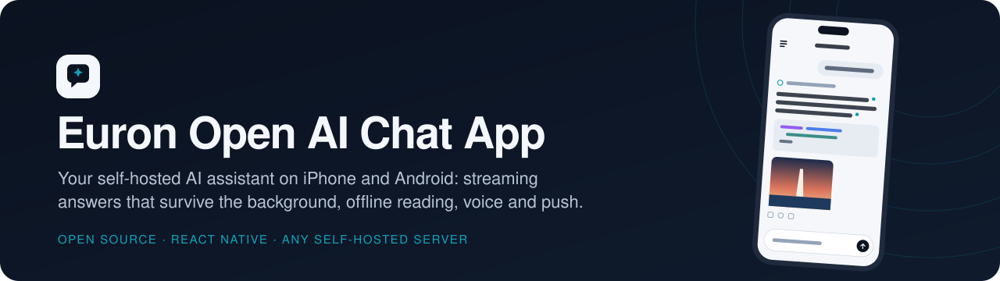
</p>

<p align="center">
  
  <a href="LICENSE"></a>
  
  
  
  
  
  
</p>

<p align="center">
  <a href="https://github.com/euron-sde-team/euron-open-ai-chat-app/stargazers"></a>
  <a href="https://github.com/euron-sde-team/euron-open-ai-chat-app/fork"></a>
  <a href="https://github.com/euron-sde-team/euron-open-ai-chat-app/watchers"></a>
  <br>
  <a href="https://github.com/euron-sde-team/euron-open-ai-chat-app/issues"></a>
  <a href="https://github.com/euron-sde-team/euron-open-ai-chat-app/pulls"></a>
  <a href="https://github.com/euron-sde-team/euron-open-ai-chat-app/commits/main"></a>
  
  <br>
  <a href="#built-by-the-team-behind-euron"></a>
</p>

<p align="center">
  <b><a href="#-quickstart">Quickstart</a></b> ·
  <b><a href="#️-architecture">Architecture</a></b> ·
  <b><a href="#-explore-the-repository">Explore the repo</a></b> ·
  <b><a href="docs/architecture/streaming-and-background.md">Streaming</a></b> ·
  <b><a href="#-release-your-own-app">Release</a></b> ·
  <b><a href="docs/architecture/security.md">Security</a></b> ·
  <b><a href="#-documentation">Docs</a></b>
</p>

**Euron Open AI Chat App** is the open-source **iOS and Android client** for
[Euron Open AI Chat](https://github.com/euron-sde-team/euron-open-ai-chat), the self-hosted AI
assistant. People sign in to their organisation's server, pick a model, ask, and watch the answer
stream in, with web search and citations, attachments, images, projects, memory, voice and a push
when a long answer is ready. It is MIT-licensed and part of the open-source initiative of
**ENGAGESPHERE TECHNOLOGY PRIVATE LIMITED**.

> [!IMPORTANT]
> **This is the client only. The server is [euron-open-ai-chat](https://github.com/euron-sde-team/euron-open-ai-chat).**
> Run it first (`make up && make demo` there): the app has no backend of its own and talks only
> to that API. One build works with any self-hosted server: the default comes from `.env`, and
> people can enter their own on the welcome screen.

It is built for how a phone is used, not as a web view in a wrapper:

- **Answers that survive the background.** A message is sent with one request (202), then the
  turn is followed over XMLHttpRequest. Leave the app mid-answer and the server keeps writing;
  come back and the app picks up after the last event it applied.
- **A push only when it helps.** If you left an answer while it was being written, and you turned
  push on, the server tells you when it is ready. Nothing else ever buzzes.
- **Readable offline.** The chat list, projects, models and the 20 most recent conversations are
  kept on the device (at most 2 MB) and open with no network. Sign out and they are gone.
- **Secure sessions.** The server's native token mode: the refresh token lives in the Keychain or
  Keystore with the server it belongs to, the access token only in memory.
- **The server decides what shows.** Web search, images, dictation, read aloud, memory, projects,
  sharing and push appear only when the server's `GET /api/meta` turns them on.

<p align="center">
  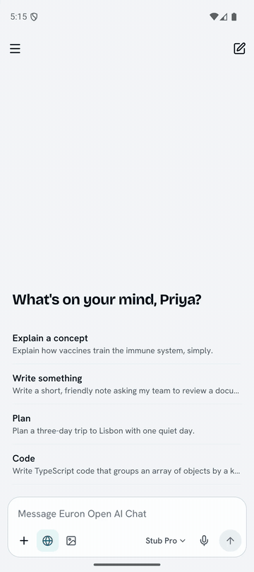
</p>

<h3 align="center">Built by the team behind Euron</h3>

<p align="center">
  <sub>Euron Open AI Chat App is part of the open-source initiative of ENGAGESPHERE TECHNOLOGY PRIVATE LIMITED, made by the people who build<br>the platforms below. If you like how this repository is built, come and see what we build with it.</sub>
</p>

<p align="center">
  <a href="https://euron.one"><picture><source media="(prefers-color-scheme: dark)" srcset="docs/assets/brand/euron-dark.svg"></picture></a>
  <a href="https://euronsystems.com"><picture><source media="(prefers-color-scheme: dark)" srcset="docs/assets/brand/euron-systems-dark.svg"></picture></a>
  <a href="https://alphaeuron.com"><picture><source media="(prefers-color-scheme: dark)" srcset="docs/assets/brand/alpha-euron-dark.svg"></picture></a>
</p>

<p align="center">
  <a href="https://www.instagram.com/euron_official"></a>
  <a href="https://www.linkedin.com/company/euronone/posts/"></a>
  <a href="https://x.com/euron712"></a>
  <a href="https://www.youtube.com/@Euron-official"></a>
  <a href="https://whatsapp.com/channel/0029VaeeJwq9RZAfPW9P2l07"></a>
</p>

---

## 📚 Table of contents

- [The family](#-the-family)
- [At a glance](#-at-a-glance)
- [Screenshots](#️-screenshots)
- [Features](#-features)
- [Architecture](#️-architecture)
  - [A turn from the phone](#a-turn-from-the-phone)
  - [Sessions](#sessions)
  - [Offline reading](#offline-reading)
- [Tech stack](#-tech-stack)
- [Prerequisites](#-prerequisites)
- [Quickstart](#-quickstart)
- [Explore the repository](#-explore-the-repository)
- [Configuration](#️-configuration)
- [Release your own app](#-release-your-own-app)
- [Security model](#-security-model)
- [Testing](#-testing)
- [Documentation](#-documentation)
- [Roadmap](#️-roadmap)
- [FAQ](#-faq)
- [Contributing, security and license](#-contributing-security-and-license)

---

## 🧩 The family

| Repository | What it is | How this app uses it |
|---|---|---|
| [euron-open-ai-chat](https://github.com/euron-sde-team/euron-open-ai-chat) | The server: API, worker, web app, admin control plane, Terraform for AWS | **Required.** The app's only server: sessions, chats and turns, files, images, speech, projects, memory, sharing, push |
| **euron-open-ai-chat-app** | This repository: the iOS and Android client | |

## 📊 At a glance

| | |
|---|---|
| **Platforms** | iOS 15.1+ and Android 7+ (API 24), one React Native 0.87 codebase, new architecture, Hermes |
| **Chat** | Streaming answers, stop, regenerate, edit a question, versions side by side (`< 2 / 3 >`), model picker, attachments (camera, photos, files), markdown with code highlighting, tables and math |
| **Tools** | Web search with numbered citations and a sources sheet, image generation, project files, memory, all as the server allows |
| **Voice** | Dictation into the composer, read aloud for answers |
| **Background** | Turns keep running on the server; the app resumes after the last event; an optional push when an answer you left is ready |
| **Offline** | The chat list, pinned chats, projects, models, preferences and the 20 most recent conversations, readable with no network |
| **Account** | Profile and photo, password, two-step sign-in with recovery codes, devices, personalization, memory, shared links, data export and account deletion, light and dark mode |
| **Servers** | Any self-hosted euron-open-ai-chat: the default from `.env`, or entered on the welcome screen (can be locked) |
| **Tests** | 37 unit and component tests in 12 suites; 10 Maestro flows written (not yet run); a contract drift check against the server |
| **License** | MIT |

## 🖼️ Screenshots

<table>
  <tr>
    <td width="33%">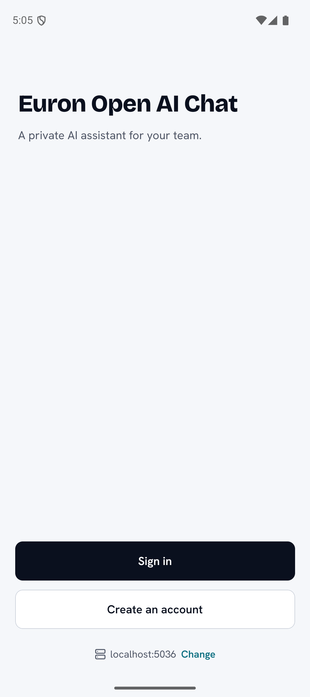<br><sub><b>Welcome.</b> The server's own name, and the server you are about to use.</sub></td>
    <td width="33%">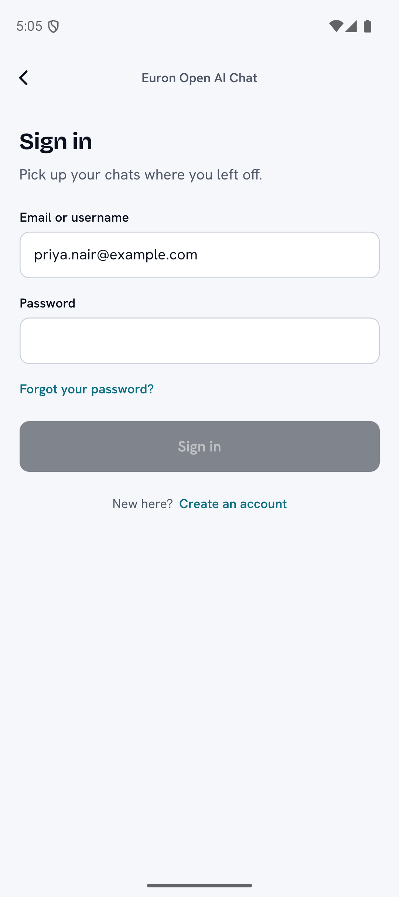<br><sub><b>Sign in.</b> Email or username, then a code when two-step sign-in is on.</sub></td>
    <td width="33%">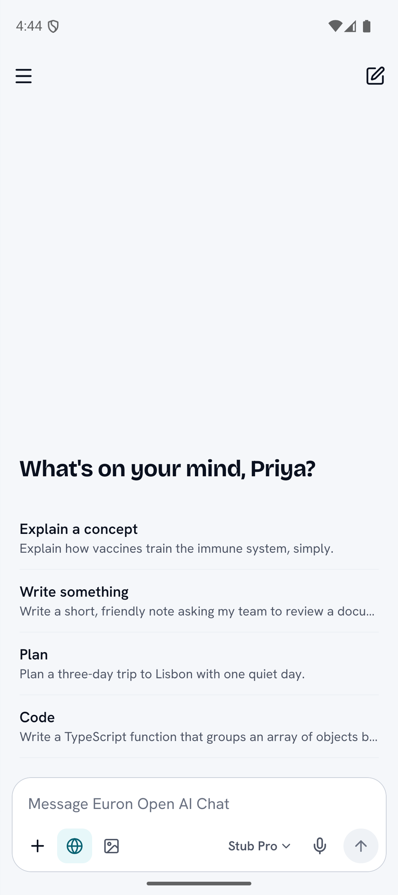<br><sub><b>New chat.</b> A greeting, a few starters and one composer.</sub></td>
  </tr>
  <tr>
    <td>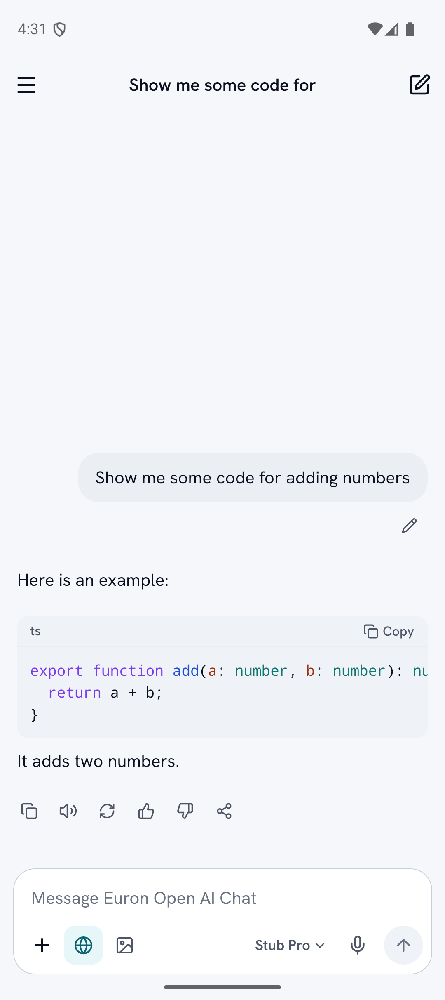<br><sub><b>Answers.</b> Native markdown: code with highlighting and copy, tables, lists.</sub></td>
    <td>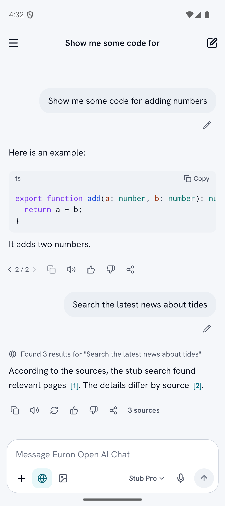<br><sub><b>Web search.</b> What the assistant did, as one quiet line; citations you can tap.</sub></td>
    <td>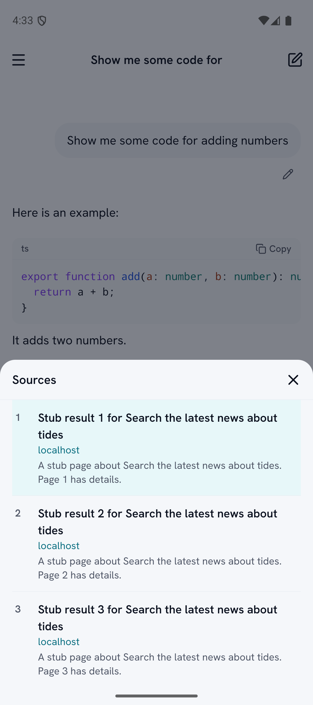<br><sub><b>Sources.</b> Every cited page, opened in the in-app browser.</sub></td>
  </tr>
  <tr>
    <td>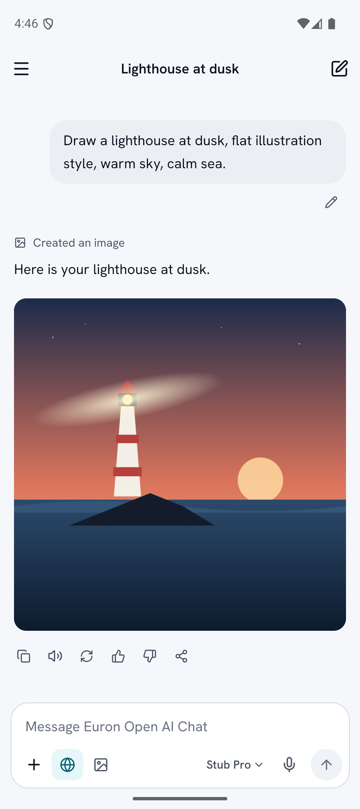<br><sub><b>Images.</b> Drawn in the chat; tap to open full screen.</sub></td>
    <td>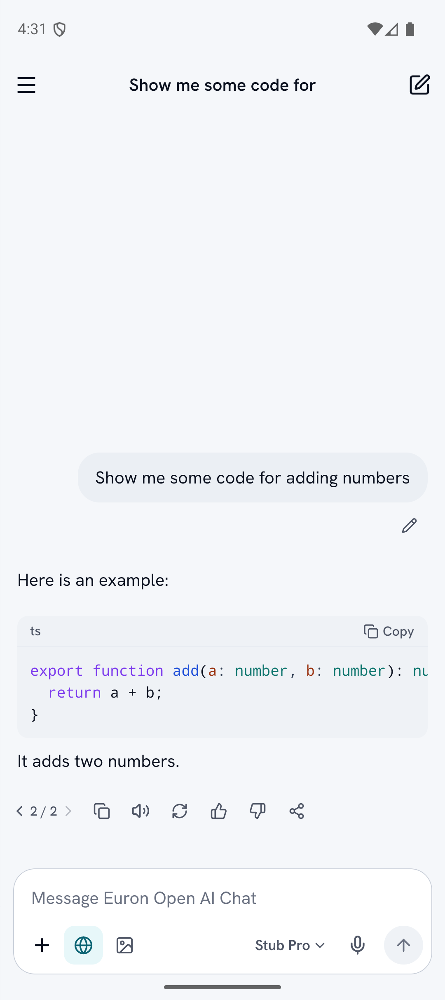<br><sub><b>Versions.</b> Regenerate or edit, and move between versions.</sub></td>
    <td>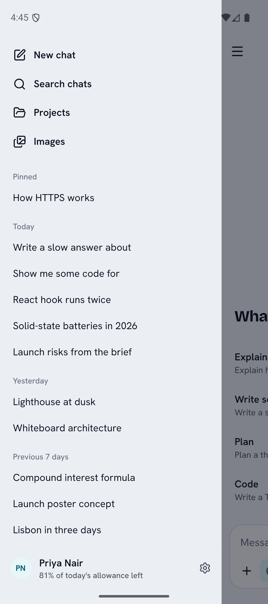<br><sub><b>Sidebar.</b> Pinned chats, then Today, Yesterday, Previous 7 days.</sub></td>
  </tr>
  <tr>
    <td>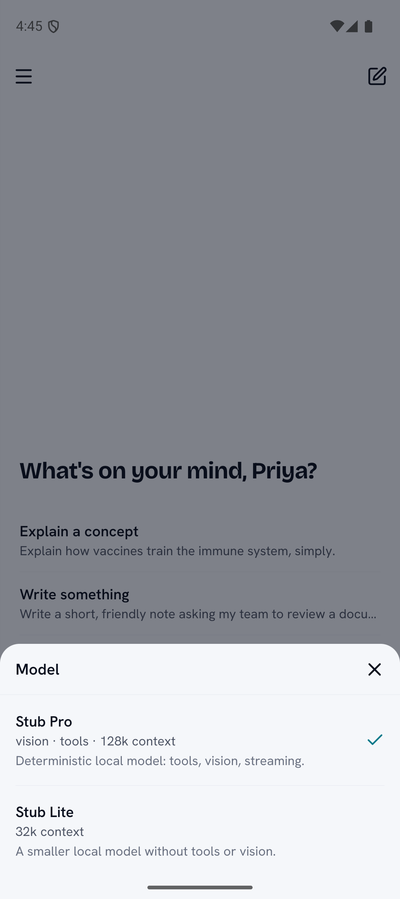<br><sub><b>Models.</b> Every model the server offers, with what it can do.</sub></td>
    <td>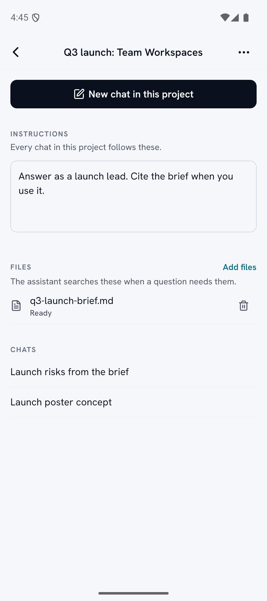<br><sub><b>Projects.</b> Standing instructions, files the assistant can search, its chats.</sub></td>
    <td>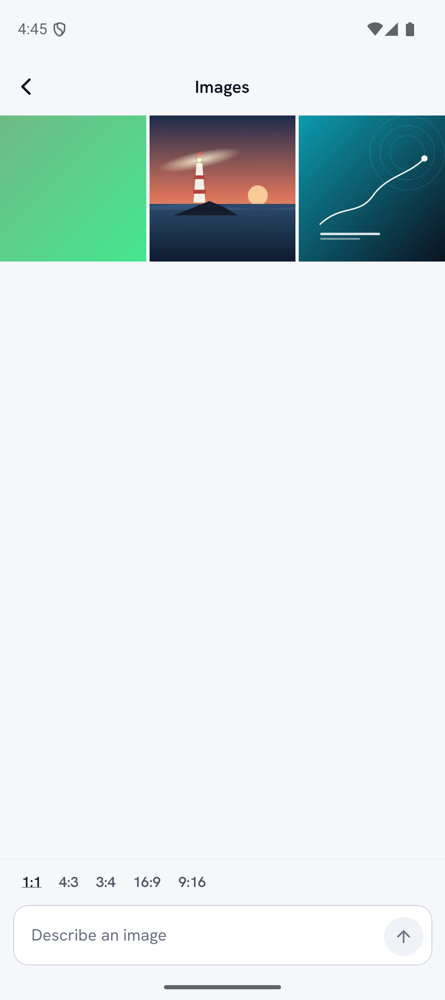<br><sub><b>Images gallery.</b> Everything you made; save, share or chat about one.</sub></td>
  </tr>
  <tr>
    <td>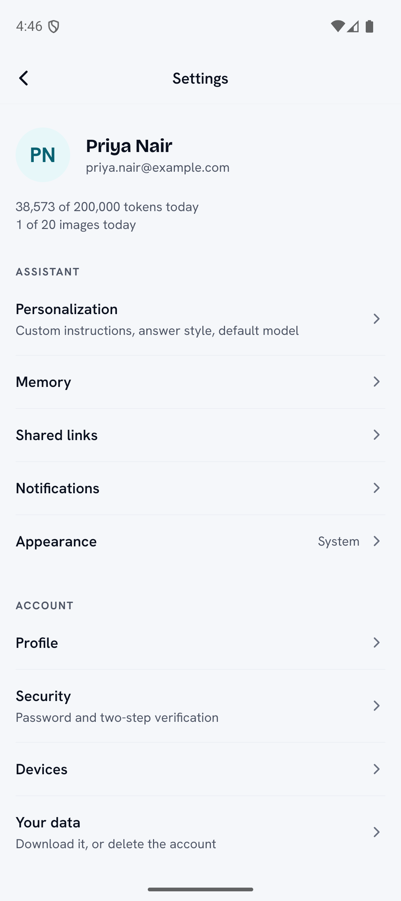<br><sub><b>Settings.</b> Personalization, memory, shared links, devices, your data.</sub></td>
    <td>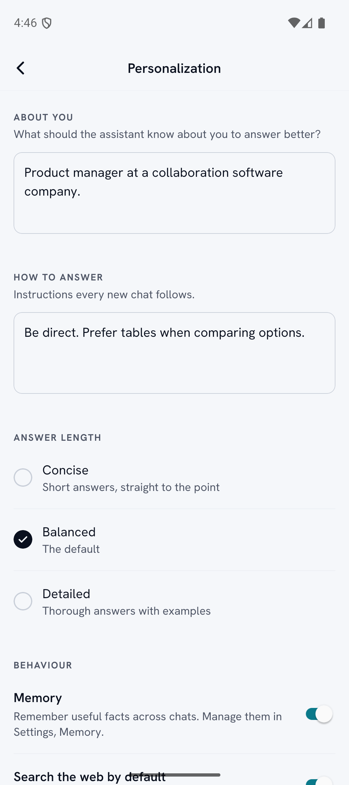<br><sub><b>Personalization.</b> How answers are shaped, the default model, the voice.</sub></td>
    <td>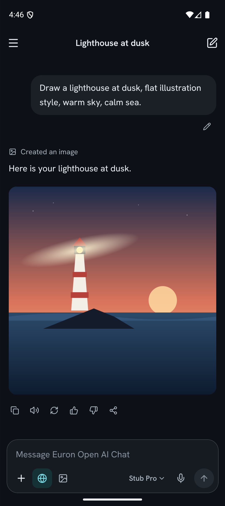<br><sub><b>Dark mode.</b> Every screen, following the system or your choice.</sub></td>
  </tr>
  <tr>
    <td>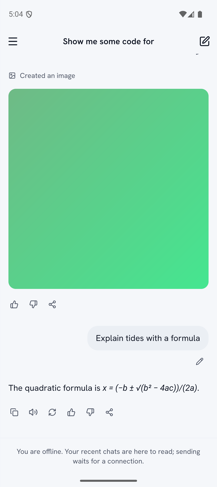<br><sub><b>Offline.</b> Recent chats open; the composer says why it cannot send.</sub></td>
    <td></td>
    <td></td>
  </tr>
</table>

## ✨ Features

| Area | What you get |
|---|---|
| **Chat** | An inverted list that stays pinned to the newest line while an answer streams; stop keeps the partial answer; regenerate and edit make a new version under the same question; copy, feedback, share and read aloud under each answer; a long press opens the same actions in a sheet |
| **Composer** | Attach from the camera, photos or Files (uploaded at once, straight to storage, with progress); tools for web search and image mode; dictation; the model; send or stop. Read-only offline with a one-line reason |
| **Markdown** | `marked` for lexing, an own renderer to native views, highlight.js for code (common languages), KaTeX to MathML for display math in a sandboxed WebView, tappable `[n]` citations, links in the in-app browser, raw HTML shown as text |
| **Sidebar and search** | New chat, search by title, projects, images, pinned chats, then chats grouped by date; rename, pin, share and delete from the chat menu |
| **Images** | Image mode in the composer, a gallery of everything you made with a prompt box, a viewer with zoom, save to Photos (add-only permission), share, or start a chat about it |
| **Projects** | Name, standing instructions, files the assistant can search, and the project's chats |
| **Voice** | Dictation (AAC from the microphone, up to 120 seconds, transcribed by the server) and read aloud (audio from the server, saved to the cache folder, played, deleted) |
| **Push** | FCM on both platforms, offered once in the chat after an answer that took more than 10 seconds, never at launch; one switch in Settings; a tap opens the chat |
| **Account** | Profile and photo, password, two-step sign-in with recovery codes, devices with sign-out per session, personalization, memory, shared links, data export, account deletion |
| **Platform** | One server at a time with a server picker; deep links on `openchat://`; light and dark themes; an update gate when the server needs a newer app; `testID`s on key elements |

## 🏗️ Architecture

<p align="center">
  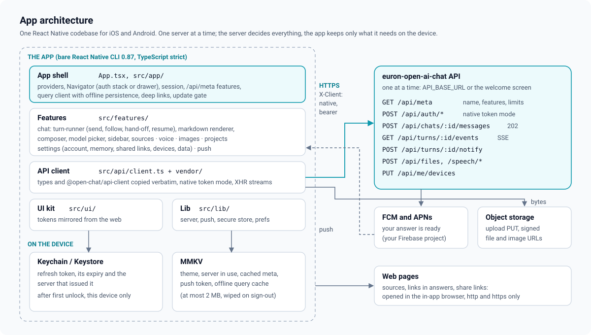
</p>

- **One server, no secrets.** Everything goes through the euron-open-ai-chat API. The app holds
  no provider keys, no admin powers and no server credential; the server decides models, limits
  and features.
- **The contract is vendored, not guessed.** `src/api/vendor` is the server's `packages/types`
  and `packages/api-client`, copied verbatim by `pnpm sync-types`, with a check that fails on
  drift.
- **Server state in TanStack Query**, persisted to MMKV for offline reading; keys in one place
  (`src/app/query.ts`). Turns write straight into the same cache, so the screen always shows
  `qk.chat(id)`.
- **Feature folders** (`src/features/{chat,voice,images,projects,settings,push,auth}`) on a small
  design system (`src/ui`) whose tokens mirror the web app's.

### A turn from the phone

<p align="center">
  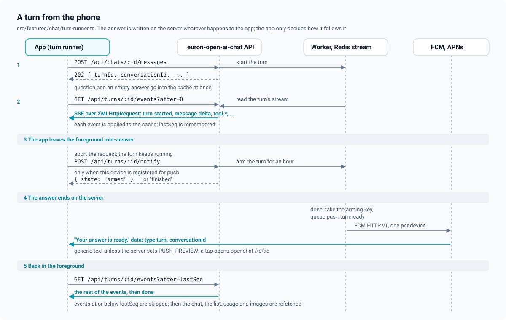
</p>

React Native's `fetch` cannot stream, so the app sends a message with one request (the server
answers `202` with the turn id) and follows `GET /api/turns/:id/events` over XMLHttpRequest. The
turn runner lives outside React, so a turn keeps streaming while screens change. When the app
leaves the foreground it stops following; the answer keeps being written on the server. If this
device is registered for push, it calls `POST /api/turns/:id/notify` for each live turn. Back in
the foreground every detached turn is followed again from the last sequence number it applied.
Details in [docs/architecture/streaming-and-background.md](docs/architecture/streaming-and-background.md).

### Sessions

Every request carries `X-Client: native`, so the server returns the refresh token in the response
body instead of a cookie. The app keeps it in the Keychain or Keystore (readable after the first
unlock, this device only) together with the server that issued it, and keeps the access token in
memory. The vendored client refreshes on a stale-token 401 with one call at a time and saves each
rotated token before using it. Changing the server signs out. Details in
[docs/architecture/sessions-and-native-tokens.md](docs/architecture/sessions-and-native-tokens.md).

### Offline reading

TanStack Query's cache is persisted to MMKV: the chat list, pinned chats, projects, models,
preferences, the server's meta and the 20 most recently opened conversations, at most 2 MB, never
an answer still being written. Started offline with a stored session, the app opens on those
chats and retries the session when the network returns. Every way a session ends wipes the cache.
Details in [docs/architecture/offline-cache.md](docs/architecture/offline-cache.md).

## 🧰 Tech stack

| Layer | Choice |
|---|---|
| App | React Native 0.87.1 (bare CLI, new architecture, Hermes), React 19.2, TypeScript strict |
| Navigation | React Navigation 7 (native stack, drawer), typed routes, deep linking |
| Data | TanStack Query 5 with a sync storage persister, the vendored `@open-chat/api-client` in native token mode |
| Storage | react-native-keychain (the refresh token), react-native-mmkv (preferences and the offline cache) |
| Markdown | marked, highlight.js (core and common languages), KaTeX with react-native-webview |
| Media and files | react-native-image-picker, @react-native-documents/picker, react-native-blob-util, @react-native-camera-roll/camera-roll, react-native-share |
| Voice | react-native-nitro-sound (record and play) |
| Push | React Native Firebase messaging (FCM, APNs through FCM) |
| UI | A small design system with the web app's tokens, Bricolage Grotesque and Hanken Grotesk (OFL), lucide icons, react-native-svg, Reanimated, Gesture Handler, Keyboard Controller |
| Quality | Jest, React Native Testing Library, Maestro, ESLint, gitleaks, a sanitisation scan |

## 📋 Prerequisites

- A running [euron-open-ai-chat](https://github.com/euron-sde-team/euron-open-ai-chat) stack
  (Docker; `make up && make demo`)
- Node.js 22.11+ and pnpm 9
- iOS: macOS with Xcode 26 or later, CocoaPods through Ruby Bundler
- Android: Android Studio with SDK 36, JDK 17, an emulator or a device

No Apple or Google developer account, no model key and no Firebase project are needed to run it
locally.

## 🚀 Quickstart

```bash
# 1. The server (in a sibling folder)
git clone https://github.com/euron-sde-team/euron-open-ai-chat.git
cd euron-open-ai-chat && make up && make demo && cd ..

# 2. The app
git clone https://github.com/euron-sde-team/euron-open-ai-chat-app.git
cd euron-open-ai-chat-app
cp .env.example .env          # points at http://localhost:5036/api
pnpm install
pnpm pods                     # iOS only
pnpm start                    # Metro on port 8098, in its own terminal

pnpm ios                      # iPhone simulator
pnpm android:reverse && pnpm android   # Android emulator or USB device
```

Sign in with the accounts that `make demo` prints (one shared password, also
`CHAT_DEMO_PASSWORD` in the server's `deploy/compose/.env`):

| Account | Try |
|---|---|
| `priya.nair@example.com` | A full history: chats, a project, images, memories, a shared link |
| `leo.marquez@example.com`, `sam.kowalski@example.com`, `amara.okafor@example.com` | Other members, for a clean start |

Locally the server's models are deterministic stand-ins, so every feature works without a key:
ask for `code`, `search the latest news`, `draw a lighthouse`, `remember ...`, a `formula`, or
something `slow` to try stop and the background hand-off. The iOS simulator reaches your Mac's
`localhost` directly; `pnpm android:reverse` forwards the stack's ports and Metro into the
emulator. The full walkthrough is in [docs/guides/quickstart.md](docs/guides/quickstart.md).

## 🧭 Explore the repository

```
App.tsx                     providers: gestures, safe area, keyboard, theme, persisted
                            server state, session, navigation
src/
  app/                      routes, navigator, deep links, session (native tokens), /api/meta
                            features, query client and offline persistence, update gate
  api/                      client.ts: the vendored client in native token mode
    vendor/                 types and api-client copied from euron-open-ai-chat (pnpm sync-types)
  features/
    auth/                   welcome, server picker, sign in and up, check email, reset, verify
    chat/                   chat screen, composer, messages, sidebar, search, model picker,
                            sources, turn-runner.ts, markdown/
    voice/                  dictation and read aloud
    images/                 gallery and viewer
    projects/               projects list and project screen
    settings/               settings and every account screen
    push/                   PushBridge (background hand-off, taps) and the in-chat offer
  ui/                       design tokens, theme, components
  lib/                      server picker, push, Keychain, MMKV, URL helpers
ios/  android/              the native projects (committed; bare React Native CLI)
scripts/                    sync-types, rename-app, android-reverse, sanitisation scan
e2e/flows/                  Maestro flows against a local euron-open-ai-chat stack
test/                       Jest setup and render helpers
docs/                       architecture, ADRs, guides
```

Start at [docs/guides/walkthrough.md](docs/guides/walkthrough.md): a tour of every screen, naming
the file behind each.

## ⚙️ Configuration

Only what the app needs before it can reach a server is set at build time, in `.env`
([`.env.example`](.env.example)):

| Key | What |
|---|---|
| `API_BASE_URL` | The default euron-open-ai-chat API, including `/api` |
| `APP_SCHEME` | The deep link scheme (`openchat` by default; `scripts/rename-app.sh` changes it everywhere) |
| `ALLOW_CUSTOM_SERVER` | `false` locks the build to `API_BASE_URL` and hides the server picker |

Everything else comes from the server at run time through `GET /api/meta`: its name, which
features are on, upload limits and the oldest app version it still supports. See
[docs/guides/configuration.md](docs/guides/configuration.md).

## 📦 Release your own app

```bash
scripts/rename-app.sh --id org.example.chat --name "Example Chat" --scheme examplechat
```

Then add your icons, set your Apple team in Xcode, put your Android keystore in
`android/keystore.properties` (never committed), and, for push, your Firebase project's
`GoogleService-Info.plist` and `google-services.json`. Without the keystore the release build is
unsigned; without the Firebase files the app simply has no push. Store notes are in
[docs/guides/release.md](docs/guides/release.md) and [docs/guides/push.md](docs/guides/push.md).

## 🔐 Security model

- **Secrets:** the refresh token lives only in the Keychain or Keystore (after first unlock,
  this device only), stored with the server that issued it and never sent to another; the access
  token only in memory; nothing secret in MMKV.
- **Transport:** HTTPS for public hosts. Plain HTTP only to local addresses, for a development
  server (iOS `NSAllowsLocalNetworking`, Android debug builds).
- **Content:** answers render as native views; raw HTML is never interpreted; math runs in a
  WebView with no network, no navigation and a `default-src 'none'` policy; links leave the app
  only as http or https.
- **Data on the device:** the offline cache is wiped on every sign-out, session end and server
  change; push text is generic unless the server operator turns previews on.
- **The repository:** no keys, Firebase files or signing material are committed; a sanitisation
  scan runs in CI and gitleaks in the full pipeline.

Details and the limits we know about are in
[docs/architecture/security.md](docs/architecture/security.md) and the
[threat model](docs/architecture/threat-model.md). To report a vulnerability, see
[SECURITY.md](SECURITY.md).

## 🧪 Testing

| Suite | What it proves | Run |
|---|---|---|
| Unit and component (36 in 12 suites) | The turn runner (202 then XHR, background hand-off with notify, resume after the last seq), the offline cache trim, server address rules and probing, push decisions and the offer, feature defaults and version checks, markdown parsing, highlighting and rendering (citations, math), the model choice, date groups, settings formatting | `pnpm test` |
| Contract | The vendored types and client match euron-open-ai-chat | `pnpm sync-types:check` |
| End to end (Maestro, 10 flows) | Welcome and server, sign-in, stream and regenerate, stop, web search and sources, images, projects, share and memory, offline reading, settings and sign-out. **Written, not yet run in this repository** | `pnpm e2e:ios` / `pnpm e2e:android` |
| Hygiene | ESLint with zero warnings, TypeScript strict, the sanitisation scan | `pnpm lint`, `pnpm typecheck`, `pnpm sanitize` |

Verified: lint, typecheck, the Jest suite, the contract check, an iOS simulator debug build that
launches against a local server, and an Android emulator debug build driven through every main
journey by hand (the screenshots above come from that run). How to run each suite is in
[docs/guides/testing.md](docs/guides/testing.md).

## 📖 Documentation

| Architecture | Guides |
|---|---|
| [High-level design](docs/architecture/HLD.md) | [Quickstart](docs/guides/quickstart.md) |
| [App architecture](docs/architecture/app-architecture.md) | [iOS](docs/guides/ios.md) and [Android](docs/guides/android.md) |
| [Streaming and the background](docs/architecture/streaming-and-background.md) | [Configuration](docs/guides/configuration.md) |
| [Offline cache](docs/architecture/offline-cache.md) | [Push notifications](docs/guides/push.md) |
| [Push](docs/architecture/push.md) | [Release and signing](docs/guides/release.md) |
| [Sessions and native tokens](docs/architecture/sessions-and-native-tokens.md) | [Testing](docs/guides/testing.md) |
| [Markdown rendering](docs/architecture/markdown-rendering.md) | [Troubleshooting](docs/guides/troubleshooting.md) |
| [Voice](docs/architecture/voice.md) | [Walkthrough: every screen](docs/guides/walkthrough.md) |
| [Security](docs/architecture/security.md) and [threat model](docs/architecture/threat-model.md) | [End-to-end flows](e2e/README.md) |
| [Decision records](docs/architecture/adr/README.md) | |

Server documentation worth reading next to these:
[mobile clients](https://github.com/euron-sde-team/euron-open-ai-chat/blob/main/docs/guides/mobile-clients.md),
[streaming](https://github.com/euron-sde-team/euron-open-ai-chat/blob/main/docs/api/streaming.md),
[push](https://github.com/euron-sde-team/euron-open-ai-chat/blob/main/docs/guides/push.md).

## 🗺️ Roadmap

- Run the Maestro flows in CI on an Android emulator and an iOS simulator
- Test and enable R8 minification for release builds
- Tablet layouts with the sidebar always open
- Share into the app from other apps (text, photos, files)
- Inline math as real math instead of the code face
- More languages for the app's own text

Ideas and pull requests are welcome: open an issue to discuss larger changes first.

## ❓ FAQ

<details>
<summary><b>Do I need euron-open-ai-chat?</b></summary>

Yes. This app is a client and has no backend of its own. Run the server locally with
`make up && make demo`, or deploy it to AWS with its Terraform, and point `API_BASE_URL` at it
(or enter the address on the welcome screen).
</details>

<details>
<summary><b>Can one build talk to different servers?</b></summary>

Yes. The welcome screen has a server picker: the address is checked with `GET /api/meta` before
it is accepted, plain HTTP is allowed only for local addresses, and switching signs out. A company
that ships its own app sets `ALLOW_CUSTOM_SERVER=false` to lock the build to its server.
</details>

<details>
<summary><b>What happens when I leave the app mid-answer?</b></summary>

The answer keeps being written on the server. The app stops following it and, if you turned push
on, asks the server to tell you when it is ready. When you come back, the app follows the turn
again from the last event it applied. If the app was killed before it could ask, there is no push,
but the answer is there on the next launch.
</details>

<details>
<summary><b>Do I need Firebase?</b></summary>

Only for push. Without `GoogleService-Info.plist` and `google-services.json` the app builds and
runs with push off; everything else works. The server also needs `PUSH_PROVIDER=fcm` with its own
service account key.
</details>

<details>
<summary><b>Expo?</b></summary>

No: a bare React Native CLI project with committed native folders, for control over linking,
dynamic frameworks for React Native Firebase, and hand-written security settings. The reasoning is
in [ADR 0001](docs/architecture/adr/0001-bare-react-native-cli.md).
</details>

<details>
<summary><b>Is the demo data real?</b></summary>

No. Every person and chat comes from the server's demo seed: fictional people on reserved example
domains, and answers from local stand-in models.
</details>

## 🤝 Contributing, security and license

- Contributions: read [CONTRIBUTING.md](CONTRIBUTING.md) and the
  [code of conduct](CODE_OF_CONDUCT.md). API changes start in euron-open-ai-chat, then
  `pnpm sync-types` here.
- Security issues: please report privately, as described in [SECURITY.md](SECURITY.md).
- License: [MIT](LICENSE). The bundled fonts are under the SIL Open Font License
  ([src/assets/fonts/OFL.txt](src/assets/fonts/OFL.txt)).

Released under the [MIT License](LICENSE). Copyright (c) 2026 ENGAGESPHERE TECHNOLOGY
PRIVATE LIMITED and the Euron Open AI Chat App contributors.

<p align="center">
  <sub>If Euron Open AI Chat App is useful to you, <a href="https://github.com/euron-sde-team/euron-open-ai-chat-app/stargazers">star the repository</a>: it helps others find it.</sub>
</p>
