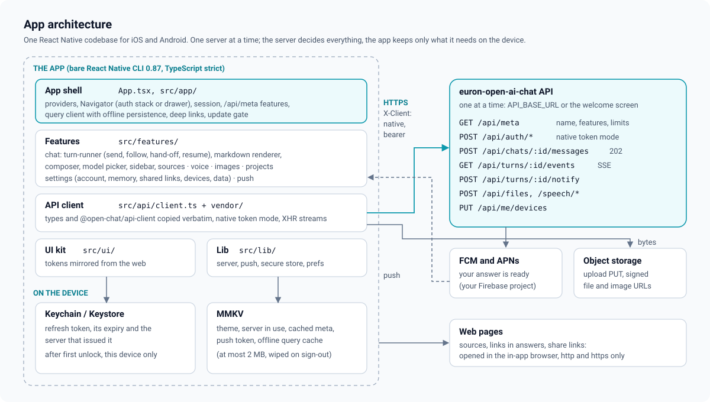

# High-level design

Euron Open AI Chat App is the iOS and Android client for a self-hosted euron-open-ai-chat
server. It is a bare React Native 0.87 app (TypeScript strict, New Architecture, Hermes) that
talks to exactly one server at a time. People sign in, chat with the models the server offers,
use the tools the server turns on (web search, images, project files, memory), dictate and listen,
read recent chats offline, and get a push when an answer they left is ready.

This page describes the app as it is built. Deeper topics have their own pages:

| Topic | Page |
| --- | --- |
| Folders, navigation, server state, theming, tests | [app-architecture.md](app-architecture.md) |
| Sending, following a turn, the background hand-off, resume | [streaming-and-background.md](streaming-and-background.md) |
| What is kept for offline reading, and when it is wiped | [offline-cache.md](offline-cache.md) |
| Push registration, the offer, taps | [push.md](push.md) |
| Native token mode, Keychain, refresh, server changes | [sessions-and-native-tokens.md](sessions-and-native-tokens.md) |
| Markdown, code, math and citations | [markdown-rendering.md](markdown-rendering.md) |
| Dictation and read aloud | [voice.md](voice.md) |
| Security controls and known limitations | [security.md](security.md) |
| STRIDE analysis | [threat-model.md](threat-model.md) |
| Decisions and their trade-offs | [adr/](adr/README.md) |

Server behaviour (turns, tools, quotas, push sending) is documented in
[euron-open-ai-chat](https://github.com/euron-sde-team/euron-open-ai-chat/blob/main/docs/architecture/HLD.md);
this repository documents what the app does with it. Code paths are relative to the repository
root.

## 1. System context

| Party | What the app exchanges with it | Code |
| --- | --- | --- |
| euron-open-ai-chat API (`API_BASE_URL` or the address entered on the welcome screen, including `/api`) | Every read and write: meta, sessions, chats and turns, messages, files, images, speech, projects, memory, shares, preferences, devices. JSON over HTTPS with `X-Client: native` and a bearer token; turn events as Server-Sent Events over XMLHttpRequest | [`src/api/client.ts`](../../src/api/client.ts) |
| Object storage behind the server (S3 or its local emulator) | Attachment bytes go up with a `PUT` to a presigned URL from `POST /api/files`; images and files come down from signed URLs the API returned | [`src/features/chat/attachments.ts`](../../src/features/chat/attachments.ts) |
| FCM and APNs | The device's FCM token goes to `PUT /api/me/devices`; one kind of message comes back: "your answer is ready" | [`src/lib/push.ts`](../../src/lib/push.ts) |
| Web pages | Sources, links in answers and share links open in the in-app browser (http and https only) | [`src/features/chat/markdown/Markdown.tsx`](../../src/features/chat/markdown/Markdown.tsx) |
| App Store and Google Play | Distribution, and the store link in the update gate | [`src/app/UpdateGate.tsx`](../../src/app/UpdateGate.tsx) |

The app holds no server secret and no model key. What a server offers (its name, registration
mode, which features are on, upload limits, the oldest supported app version) comes from
`GET /api/meta` ([ADR 0010](adr/0010-features-switched-by-the-server.md)). Build-time settings are
only what the app needs before it can reach a server ([configuration guide](../guides/configuration.md)).

## 2. Layers

| Layer | Folder | Holds | May import |
| --- | --- | --- | --- |
| App shell | [`App.tsx`](../../App.tsx), [`src/app/`](../../src/app/) | Providers, the navigator and route table, deep links, the session, `/api/meta`, the query client and its persistence, the update gate | everything |
| Features | [`src/features/<area>/`](../../src/features/) | Screens and their logic: `auth`, `chat` (with `turn-runner.ts` and `markdown/`), `voice`, `images`, `projects`, `settings`, `push` | app shell hooks, api, ui, lib |
| API | [`src/api/`](../../src/api/) | `client.ts` and the vendored contract (`vendor/`: the server's types and `@open-chat/api-client`, copied verbatim) | nothing app-specific |
| UI kit | [`src/ui/`](../../src/ui/) | Design tokens mirrored from the web, `ThemeProvider`, Text, Button, Layout, Inputs, Feedback, Media, Sheet, Toast | lib |
| Lib | [`src/lib/`](../../src/lib/) | `server.ts` (the server picker), `push.ts`, `secure-store.ts` (Keychain/Keystore), `storage.ts` (MMKV), `urls.ts` | api types |

Providers in [`App.tsx`](../../App.tsx), outermost first: gesture handler, safe area, keyboard,
theme, the persisted query client, session, navigation. While signed in, the navigator mounts
`PushBridge`, which binds the turn runner and owns the background hand-off and push taps.

## 3. How a screen gets its data

1. A screen calls a hook (`useQuery` with a key from `qk` in
   [`src/app/query.ts`](../../src/app/query.ts)) whose query function calls the typed client from
   `useApi()`.
2. The vendored client adds `X-Client: native` and the in-memory access token.
3. A `401` for a stale token triggers one shared refresh; the rotated refresh token is written to
   the Keychain before it is used ([sessions](sessions-and-native-tokens.md)).
4. Errors arrive as `ApiError` with a stable `code`; screens switch on the code.

Turns are the exception: the turn runner writes events straight into `qk.chat(id)`, so the chat
screen just renders the cached conversation ([streaming](streaming-and-background.md)).

## 4. Offline

- **Start offline.** With a stored session and no network at launch, the session status is
  `offline` and the signed-in app opens anyway on the cached chats. The session is retried as soon
  as NetInfo reports a connection ([`Navigator.tsx`](../../src/app/Navigator.tsx)).
- **Read offline.** The persisted cache holds the chat list, pinned chats, projects, models,
  preferences, meta and the 20 most recent conversations ([offline cache](offline-cache.md)). The
  composer is read-only with a one-line reason.

Writes are never queued: sending waits for a connection.

## 5. Failure behaviour

| Failure | What people see |
| --- | --- |
| Server unreachable at launch, session stored | The cached chats, then the full app once online |
| Server unreachable at launch, no session | The welcome screen says the server cannot be reached (and offers to change it when allowed) |
| A server address that is not an Open AI Chat server | Refused on the server screen with a reason; the current server stays |
| Refresh token rejected (expired, revoked, reused) | Signed out locally, cache wiped, welcome screen |
| Connection lost while following a turn in the foreground | The answer shows "The connection was lost. Open the chat again to see the answer." Opening the chat again rejoins the turn if it is still streaming |
| App sent to the background mid-answer | The turn continues on the server; followed again from the last event on return |
| App killed mid-answer | No push for that answer; the answer is there on the next open |
| App older than the server's `minSupportedVersion` | The update gate blocks the app with a store link |
| No Firebase config in the build | No push. The offer never appears; the Notifications switch is disabled with "This build of the app has no notification service set up." |
| A feature off on the server | Its controls are not shown |
