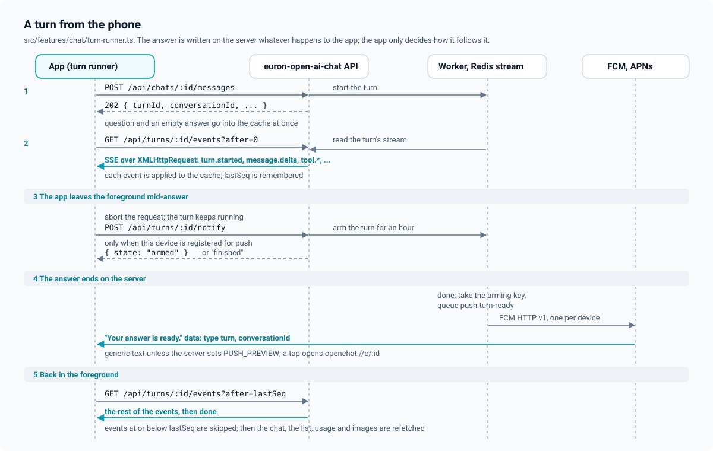

# Streaming and the background

How the app sends a message, follows the answer as it is written, lets go of it when the phone
goes to the background, and picks it up again. All of it is in
[`src/features/chat/turn-runner.ts`](../../src/features/chat/turn-runner.ts), ported from the
server repository's web app (`apps/web/src/lib/chat/turn-runner.ts`) with three phone-specific
changes. The server side of turns is in
[streaming.md](https://github.com/euron-sde-team/euron-open-ai-chat/blob/main/docs/api/streaming.md)
and [mobile-clients.md](https://github.com/euron-sde-team/euron-open-ai-chat/blob/main/docs/guides/mobile-clients.md).

## 1. Why send, then follow

React Native's built-in `fetch` cannot read a response body as it arrives, so the server's
"stream on the same response" mode is not usable. The app uses the other mode the server offers:

1. `POST /api/chats/:id/messages` (`:id` is `new` for a new chat) without
   `Accept: text/event-stream`. The server starts the turn and answers `202 TurnStarted`:
   `{ turnId, conversationId, userMessageId, assistantMessageId }`.
2. `GET /api/turns/:turnId/events?after=<seq>` through the vendored client's
   `turns.follow(turnId, { after, signal, transport: "xhr" })`. The XHR transport parses the
   growing response text on every progress event.

The turn runs on the server whatever happens to the connection. Closing the request stops the
app's view of the turn, not the turn ([ADR 0005](adr/0005-send-then-follow-over-xhr.md)).

## 2. The runner

Runners live outside React, in a module-level map of running turns, so an answer keeps streaming
while the person moves between screens. `PushBridge` binds the runner to the signed-in client and
query cache (`bindTurnRunner`) and unbinds it on sign-out, which detaches every turn.

Each running turn remembers `turnId`, `conversationId`, the answer's id, `lastSeq` (the highest
sequence number applied), an `AbortController`, whether it is `detached`, and when it started.
Screens subscribe to `turnState` (`activeIn(conversationId)`, `isRunning`, `errorOf`).

### Sending

`sendMessage()`:

1. Calls `api.chats.send()` and waits for the 202.
2. Writes the conversation into `qk.chat(id)` at once: the messages up to the parent being
   continued, the question (with its attachments as the composer held them) and an empty answer
   with status `STREAMING`. `currentLeafId` points at the new answer and `activeTurnId` at the
   turn. A new chat also invalidates the chat list.
3. Starts following from sequence 0 and resolves with the conversation id, so a new chat can
   navigate to its id.

`regenerate()` does the same through `POST /api/messages/:id/regenerate`: a new sibling answer
under the same question, with the previous versions kept in `siblingIds` for the `< 2 / 3 >`
switcher. Editing a question sends a new message with the same parent, which makes a sibling
question.

### Applying events

`applyEvent()` (exported for tests) patches the cached answer:

| Event | Effect on the cached answer |
| --- | --- |
| `turn.started` | Sets the model that answers |
| `message.delta` | Appends text |
| `reasoning.delta` | Appends reasoning |
| `tool.started` | Adds a running step with the label the server sends |
| `tool.finished` | Marks the last running step done or failed, merges new sources by number, adds a generated image |
| `message.completed` | Replaces the text and sources with the final ones; status `COMPLETE` |
| `title` | Renames the conversation in the list and the open chat |
| `error` | Status `FAILED` with the error code; keeps the readable message for the screen |
| `done` | Final status (`COMPLETE`, `CANCELLED` or `FAILED`) |

Events with a sequence number at or below `lastSeq` are skipped, so a reconnect never applies
anything twice.

### Ending

When a turn ends in the foreground, the runner removes it, clears `activeTurnId` in the cached
conversation (so a screen that mounts before the refetch does not rejoin a finished turn), and
invalidates the conversation, the chat list, usage and images. If the turn ended normally it
reports how long it took, which drives the push offer ([push.md](push.md)).

### Connection drops

The vendored client reconnects by itself: on a network error or a stream that closes without
`done` it waits (400 ms doubling, at most 8 seconds) and calls again with `?after=<last seq>`, up
to 8 times. A 4xx other than 408 and 429 is not retried. Only when it gives up does the runner mark
the answer `FAILED` with "The connection was lost. Open the chat again to see the answer."

### Stop

`stop(turnId)` calls `POST /api/turns/:id/cancel`. The server ends the turn with `done` and status
`CANCELLED`, keeping the partial answer; the runner applies that like any other event.

## 3. The background hand-off

`PushBridge` listens to `AppState`. When the app goes from `active` to `inactive` or `background`:

1. `handOffToBackground(canPush)` marks every live turn `detached` and aborts its request. The
   turns stay registered in the runner.
2. When `canPush` is true it calls `POST /api/turns/:id/notify` for each. `canPush` comes from
   `canReceivePush()`: the server reports `features.push` and this device has a registered push
   token. The answer is `{ state: "armed" }`, or `{ state: "finished" }` when the turn ended
   first (then nothing is sent and the app simply follows the turn on return). Errors are ignored:
   the answer is saved on the server either way.

The server arms the turn for an hour and sends one push per device of the account when it ends
([server ADR 0015](https://github.com/euron-sde-team/euron-open-ai-chat/blob/main/docs/architecture/adr/0015-push-opt-in-per-answer.md)).

On iOS, `inactive` also covers short interruptions such as pulling down Control Center or opening
the app switcher. The hand-off happens then too; the turn is followed again a moment later on
return, with no visible loss.

## 4. Coming back

When `AppState` becomes `active` again, `resumeDetached()` restarts every detached turn with a new
`AbortController` and the same `lastSeq`, so it continues with `?after=lastSeq`. Events already
applied are not requested again, and events written while the app was away arrive at once.

## 5. Opening a chat mid-answer

A conversation can load while its answer is still being written: from a push tap, from the
sidebar after the app was restarted, or on another device's turn. Its `activeTurnId` is set and
that message has status `STREAMING`. `resume(detail)` then rejoins the turn. The stored answer is
empty until the turn ends, so it clears the cached answer and follows from sequence 0; the server
replays every event (it keeps them for an hour).

## 6. Sign-out

`detachAll()` aborts every request and forgets every turn. The turns continue on the server; the
next person to sign in on the phone never sees them.

## 7. Tests

[`turn-runner.test.ts`](../../src/features/chat/turn-runner.test.ts) covers: building an answer
from deltas, tool steps, sources, images and the final message; an error event; sending with a
202, following over XHR and showing the question at once; going to the background (stop following
and arm a push) and coming back (resume after the last seq); and a hand-off without push that arms
nothing.
