# Walkthrough: every screen

A tour of the app from first launch to sign-out, against a local server with the demo data
(`make up && make demo` in euron-open-ai-chat). Each step names the file behind the screen. The
screenshots come from the debug app on a simulator or emulator.

## 1. Welcome

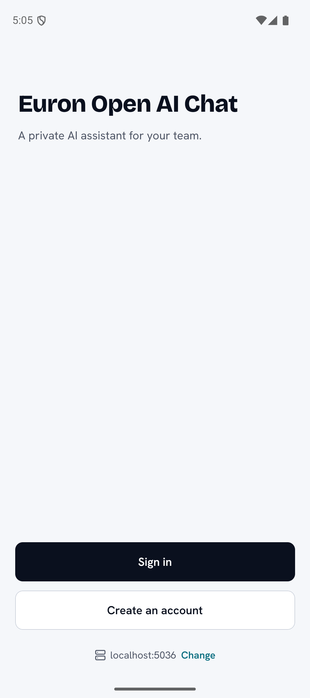

The first screen shows the server's own name and tagline from `GET /api/meta`, **Sign in**,
**Create an account** (only when the server's registration is open) and the server in use. If the
server cannot be reached it says so, and offers to change it.

Tapping the server opens the **server picker**: type an address, and the app normalises it (https,
`/api`), checks `GET /api/meta` and accepts it only if it answers like an Open AI Chat server.
Switching signs out of the previous server. A build with `ALLOW_CUSTOM_SERVER=false` shows no
picker.

Files: `WelcomeScreen` and `ServerScreen` in
[`AuthScreens.tsx`](../../src/features/auth/AuthScreens.tsx), [`server.ts`](../../src/lib/server.ts).

## 2. Sign in

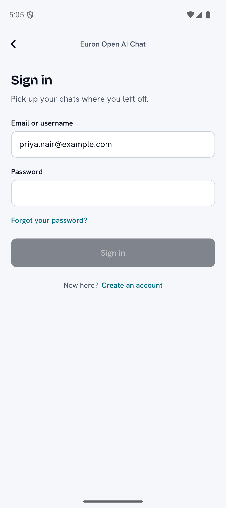

Email or username and password. With two-step sign-in on, the screen asks for the six digit code
or a recovery code. Wrong details show the server's message. **Forgot your password?** sends a reset
link by mail; **Create an account** shows sign-up, and when the server requires verification, a
"check your email" screen.

Sign-in returns a native session: the refresh token goes to the Keychain or Keystore, the access
token stays in memory ([sessions](../architecture/sessions-and-native-tokens.md)).

Files: `SignInScreen`, `SignUpScreen`, `CheckEmailScreen`, `ForgotPasswordScreen` in
[`AuthScreens.tsx`](../../src/features/auth/AuthScreens.tsx), [`session.tsx`](../../src/app/session.tsx).

## 3. A new chat

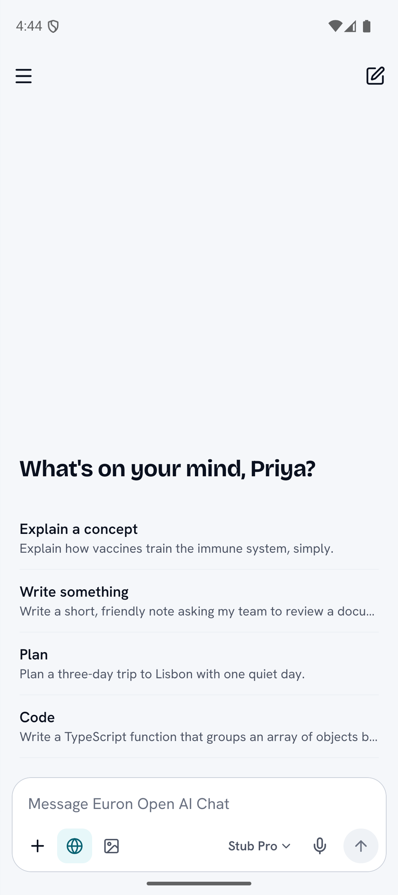

An empty chat shows a greeting and a few starter prompts. The composer is one surface at the bottom:
the text, then quiet controls for attachments, tools (web search, image mode), dictation, the model
and send. Only what the server turned on is shown.

Files: [`ChatScreen.tsx`](../../src/features/chat/ChatScreen.tsx),
[`Composer.tsx`](../../src/features/chat/Composer.tsx).

## 4. An answer

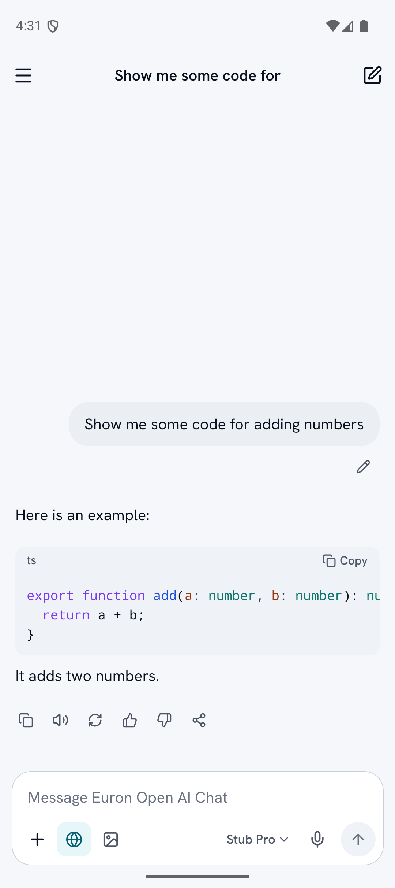

Send, and the question appears at once with an empty answer that fills as the turn streams. The list
stays pinned to the newest line unless you scroll up. **Stop** ends the answer and keeps what was
written. Under a finished answer: copy, read aloud, regenerate, thumbs up and down, share. A long press opens
the same actions in a sheet.

Answers are native markdown: headings, lists, tables that scroll sideways, code with highlighting and
**Copy**, and display math.

Files: [`turn-runner.ts`](../../src/features/chat/turn-runner.ts),
[`MessageView.tsx`](../../src/features/chat/MessageView.tsx),
[`markdown/`](../../src/features/chat/markdown/) ([markdown rendering](../architecture/markdown-rendering.md)).

## 5. Web search and sources

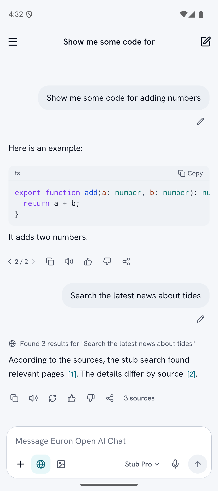
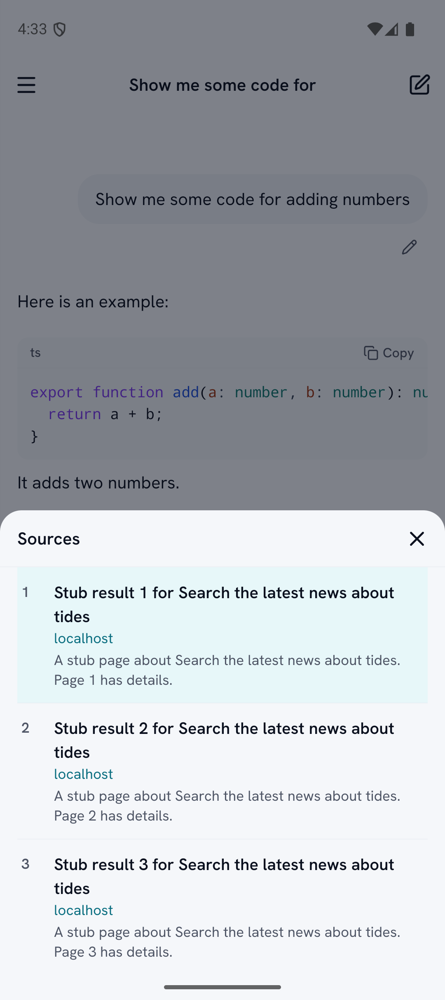

With web search on, what the assistant did shows above the answer as one muted line (the server's
step label, for example "Found 3 results for ..."), and the answer cites sources as `[1]`, `[2]`. A
citation opens that source; the **3 sources** button lists every one with its title, domain and
snippet. Under the answer: copy, read aloud, regenerate, thumbs up and down, and share. Links open in the in-app browser.

Files: [`MessageView.tsx`](../../src/features/chat/MessageView.tsx),
[`SourcesSheet.tsx`](../../src/features/chat/SourcesSheet.tsx).

## 6. Images in the chat

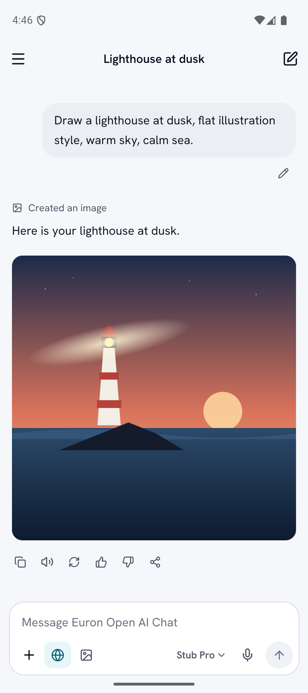

In image mode the assistant draws a picture and it appears under the answer. Tap it to open the
viewer: zoom, save to Photos, share, or start a chat about it.

Files: [`images/index.tsx`](../../src/features/images/index.tsx) (`ImageViewerScreen`).

## 7. Versions

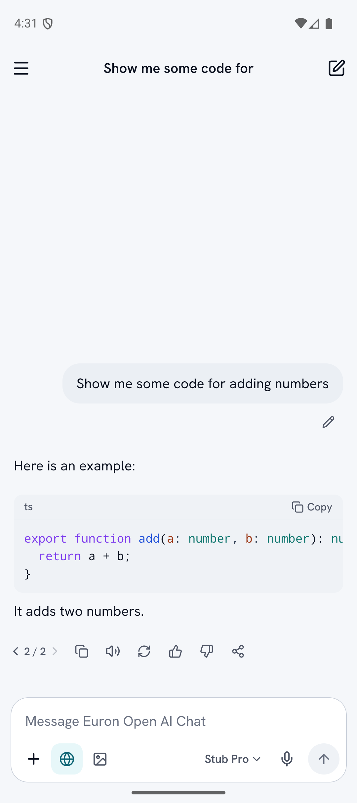

**Regenerate** writes a new answer under the same question; **Edit** on your own message sends a new
version of the question. Both keep the old version: `< 2 / 2 >` moves between them, and the server
remembers which one you are on.

Files: [`MessageView.tsx`](../../src/features/chat/MessageView.tsx),
[`actions.ts`](../../src/features/chat/actions.ts) (`setLeaf`).

## 8. The sidebar

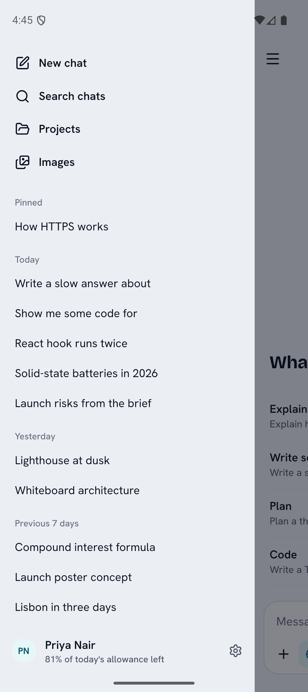

Swipe from the left edge or tap the menu. At the top: new chat, search, projects and images. Then
pinned chats, and the rest grouped under Today, Yesterday, Previous 7 days, Previous 30 days, then
months. The account sits at the bottom and opens Settings. Search finds chats by title as you type.

The chat menu (top right in a chat) renames, pins, moves to a project, shares as a public link and
deletes.

Files: [`Sidebar.tsx`](../../src/features/chat/Sidebar.tsx),
[`SearchScreen.tsx`](../../src/features/chat/SearchScreen.tsx),
[`queries.ts`](../../src/features/chat/queries.ts).

## 9. The model picker

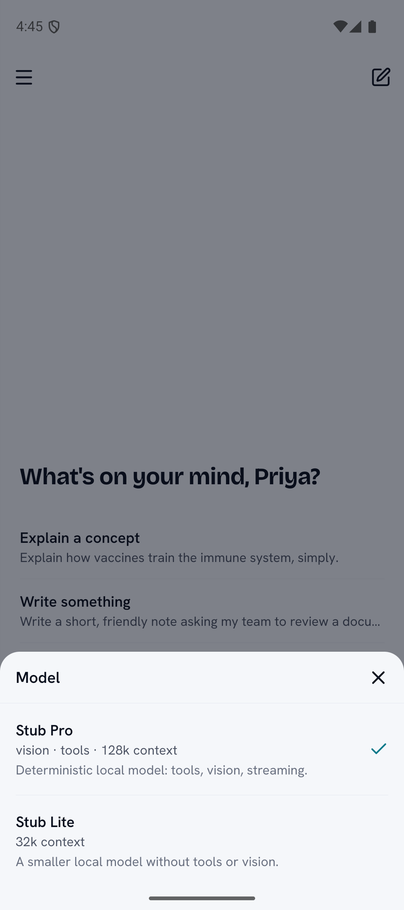

The model's name in the composer opens a sheet with every chat model the server offers, each with a
line of facts ("vision · tools · 128k context") and its description. The choice is remembered on
this device for new chats; Personalization sets the account default.

Files: [`ModelPicker.tsx`](../../src/features/chat/ModelPicker.tsx).

## 10. Projects

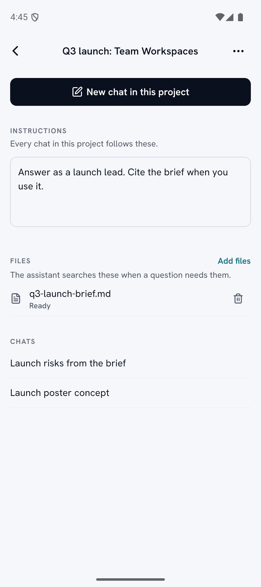

A project has a name, standing instructions every chat in it follows, files the assistant can search,
and its chats. **New chat in** a project starts a chat that answers from its files when asked.

Files: [`projects/index.tsx`](../../src/features/projects/index.tsx).

## 11. Images gallery

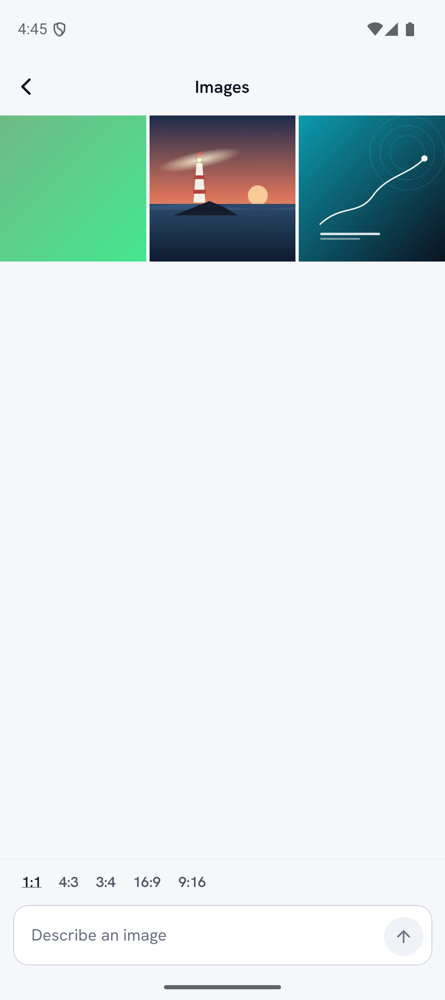

Everything this account generated, newest first, with a prompt box to make another. Saving asks only
for add-only access to Photos.

Files: [`images/index.tsx`](../../src/features/images/index.tsx).

## 12. Settings

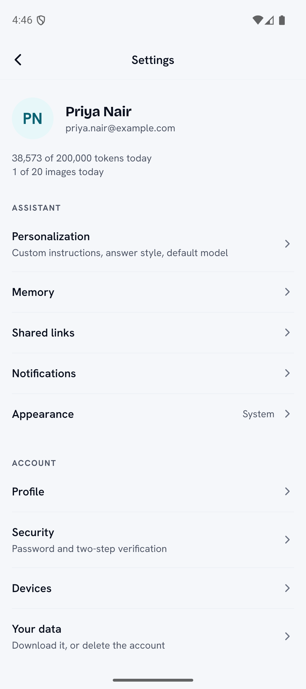

Who you are and today's usage, then three groups on hairlines:

| Group | Rows |
| --- | --- |
| Assistant | Personalization, Memory, Shared links, Notifications, Appearance |
| Account | Profile, Security (password and two-step sign-in), Devices, Your data (download or delete) |
| About | The version and build, the server, open-source notices |

Then **Sign out** and **Sign out of all devices**. Rows for features the server has off are hidden.

Files: [`settings/`](../../src/features/settings/).

## 13. Personalization

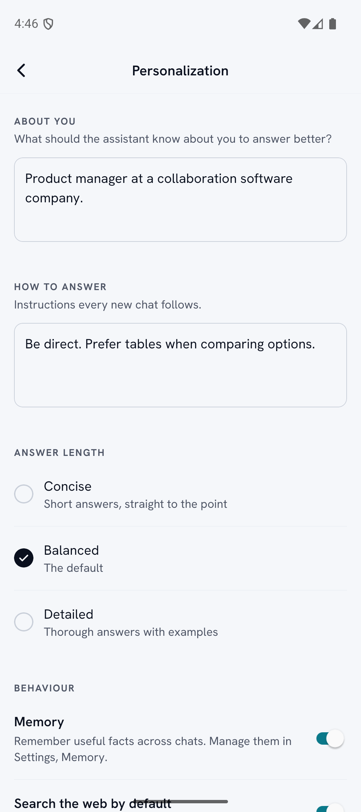

What the assistant should know about you, how it should answer, the answer length, whether it
remembers things, web search by default, the default model and the read-aloud voice. Memory lists the
facts it keeps, each deletable.

Files: [`PersonalizationScreen.tsx`](../../src/features/settings/PersonalizationScreen.tsx),
[`MemoriesScreen.tsx`](../../src/features/settings/MemoriesScreen.tsx).

## 14. Dark mode

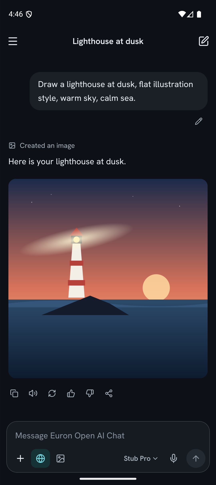

Every screen follows the system, or the choice in Settings, Appearance.

Files: [`ThemeProvider.tsx`](../../src/ui/theme/ThemeProvider.tsx),
[`tokens.ts`](../../src/ui/theme/tokens.ts).

## 15. Offline

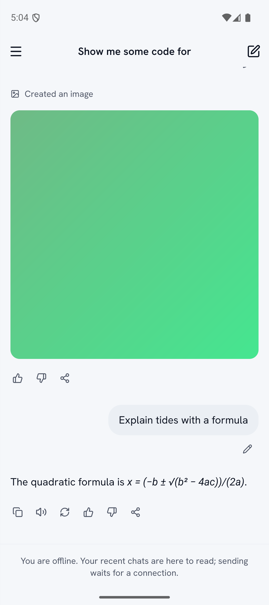

With no network, the chat list and the 20 most recent conversations still open. The composer says
"You are offline. Your recent chats are here to read; sending waits for a connection." Started
offline, the app opens on the cached chats and reconnects by itself.

Files: [`query.ts`](../../src/app/query.ts) ([offline cache](../architecture/offline-cache.md)).

## 16. Leaving mid-answer, and push

Ask for something long and switch to another app. The answer keeps being written on the server.
Come back and it continues from where the app stopped following. With push set up and turned on (the
offer appears once, after an answer that took more than 10 seconds), the phone also says "Your answer
is ready." when it finishes, and the notification opens the chat.

Files: [`PushBridge.tsx`](../../src/features/push/PushBridge.tsx),
[`PushOffer.tsx`](../../src/features/push/PushOffer.tsx)
([streaming](../architecture/streaming-and-background.md), [push](../architecture/push.md)).

## 17. Signing out

Settings, **Sign out**: the device stops receiving pushes, the session ends on the server, and the
Keychain entry, the offline cache and the push token are cleared. The app returns to the welcome
screen.

Files: [`signout.ts`](../../src/features/settings/lib/signout.ts),
[`session.tsx`](../../src/app/session.tsx).
